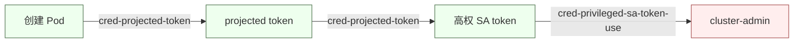

# InkBlade 全量提权矩阵（Privesc Matrix）

> 本文件由 `inkblade privesc matrix --out docs/PRIVESC-MATRIX.md` 确定性生成；请改 `inkblade/core/data/privesc-matrix.json` 后重生成，勿手改。

## 提权面

- 提权向量：**47** 条（RBAC 10 / 工作负载 9 / 凭据 9 / 节点 7 / 平台组件 12）
- 提权图：**66** 个节点 / **79** 条原语边；目标 target:cloud-admin, target:cluster-admin, target:node-root
- 检测覆盖：每向量 ≥1 条 Sigma/Falco 规则（共 47 条，紫队重放见 `inkblade privesc detections`）
- 来源：K8s 官方文档、MITRE ATT&CK、KubeHound/kube-hunter/Peirates/CDK、云厂商与平台组件文档（共 134 条引用）

### 提权路径图（规范示例）

从「创建 Pod」能力到 cluster-admin 的最短路径（权重优先）：

从「创建 Pod」到「cluster-admin」：3 步，权重 3.3
1. [cred-projected-token] Projected SA token 过度授权
   原语：在 Pod 中挂载目标 SA 的 projected token（受众/有效期可调），把 token 外带到集群外长期使用。
   前置：create pods；目标 SA 具高权绑定；audience/expiration 未限制
   证据：Kubernetes Secret 文档 https://kubernetes.io/docs/concepts/configuration/secret/
   检测：sigma:K8s audit：create pod 且 volume 使用 projected serviceAccountToken
2. [cred-privileged-sa-token-use] 高权 SA token 直接使用
   原语：以 Bearer token 调用 apiserver，创建 ClusterRoleBinding/特权 Pod；token 短期但足以完成接管。
   前置：持有高权 SA token；网络可达 apiserver
   证据：Kubernetes Secret 文档 https://kubernetes.io/docs/concepts/configuration/secret/
   检测：sigma:K8s audit：高权 SA 主体创建敏感绑定
结论：沿上述原语可到达目标；执行前需通过 ROE 级别、范围与备份校验。

### 选择依据

objective 在阶段③（提权）前自动调用 `paths(from, to='cluster-admin')`：

1. 以证据快照推断当前主体与权限，生成 0.3 权重的「当前授权」边；
2. 对攻击向量边按总权重做 K 条最短简单路径搜索（同权重按跳数少、再按向量 id 字典序稳定排序）；
3. 首选路径要求每条边的模块均已在注册表登记；执行失败时按排序回退下一条路径；
4. 选择理由、备选路径与每条边的检测键写入 objective 报告「提权面」章节。

## 向量总表

| ID | 类别 | 主体条件 | 所需权限 | 原语 | 节点影响 | 集群影响 | 云影响 | 模块 | 检测点 | 来源 |
|---|---|---|---|---|---|---|---|---|---|---|
| `rbac-escalate-verb` | RBAC 提权 | 已绑定任意 Role/ClusterRole 且拥有 escalate 动词的主体（SA/User/Group） | escalate on roles 或 clusterroles；update/patch 已绑定角色（或用 create 自建角色后绑定） | 用 escalate 把已绑定角色改写为 verbs/resources/apiGroups=*；既有绑定立即生效，无需重新授权。 | 可创建特权 Pod 间接获得节点 root | 等价 cluster-admin（全 API 写权限） | 可读云身份 Secret/SA token，进一步 AssumeRole | `rbac-escalate-verb` | K8s audit：update/patch clusterroles/roles 且新 rules.verbs 含 * | Kubernetes RBAC 文档 https://kubernetes.io/docs/reference/access-authn-authz/rbac/; MITRE ATT&CK T1098 Account Manipulation https://attack.mitre.org/techniques/T1098/; KubeHound RBAC 攻击图 https://github.com/DataDog/KubeHound |
| `rbac-bind-verb` | RBAC 提权 | 拥有 bind 动词（对 cluster-admin 或目标 ClusterRole）且可创建 RoleBinding/ClusterRoleBinding 的主体 | bind on clusterroles（resourceName=cluster-admin）；create rolebindings/clusterrolebindings | 创建指向 cluster-admin 的 ClusterRoleBinding 并绑定自身 SA；kube-apiserver 的提权防护因 bind 而放行。 | 可创建任意特权工作负载 | 直接 cluster-admin | 可读取全部云身份 Secret 与 IRSA token | `rbac-bind-verb` | K8s audit：创建/更新 roleRef=cluster-admin 的绑定 | Kubernetes RBAC 文档 https://kubernetes.io/docs/reference/access-authn-authz/rbac/; MITRE ATT&CK T1098 Account Manipulation https://attack.mitre.org/techniques/T1098/; KubeHound RBAC 攻击图 https://github.com/DataDog/KubeHound |
| `rbac-impersonate` | RBAC 提权 | 拥有 impersonate 动词（users/groups/serviceaccounts）的主体 | impersonate on users 或 groups 或 serviceaccounts；目标主体已绑定 cluster-admin 或 system:masters | 请求头 Impersonate-User/Impersonate-Group 冒充 cluster-admin 用户或组；审计只记录冒充者与被冒充者。 | 以管理员身份创建特权 Pod | 等价 cluster-admin | 可冒充云身份联合主体读取云凭据 | `impersonate-abuse` | K8s audit：impersonatedUser 字段非空且执行敏感动作 | Kubernetes 认证/授权概览 https://kubernetes.io/docs/reference/access-authn-authz/; MITRE ATT&CK T1078 Valid Accounts https://attack.mitre.org/techniques/T1078/; KubeHound RBAC 攻击图 https://github.com/DataDog/KubeHound |
| `rbac-sa-token-request` | RBAC 提权 | 拥有 create serviceaccounts/token 且目标 SA 已绑定高权角色的主体 | create serviceaccounts/token；目标高权 ServiceAccount 存在 | 调用 TokenRequest 子资源为特权 SA 申请短期 token；无需读取 Secret 即可获得其身份。 | 以特权 SA 创建 Pod 控制节点 | 以目标 SA 身份获得 cluster-admin | 可获得 IRSA/Workload Identity 交换凭据 | `sa-token-request` | K8s audit：create serviceaccounts/token 子资源 | Kubernetes TokenRequest API https://kubernetes.io/docs/reference/kubernetes-api/authentication-resources/token-request-v1/; MITRE ATT&CK T1552 Unsecured Credentials https://attack.mitre.org/techniques/T1552/; KubeHound RBAC 攻击图 https://github.com/DataDog/KubeHound |
| `rbac-pods-exec` | RBAC 提权 | 拥有 create pods/exec 的主体；目标命名空间存在特权/宿主挂载/带高权 SA 的 Pod | create pods/exec；可定位目标 Pod（get/list pods） | exec 进入特权或 hostPath 容器，读取 SA token、宿主机文件系统或直接 nsenter 到宿主命名空间。 | exec 到特权容器后可 nsenter 宿主 | 读取目标 Pod 的高权 SA token 接管集群 | 读取容器内云凭据 | `overprivileged-sa-escalation` | K8s audit：create pods/exec | Kubernetes RBAC 文档 https://kubernetes.io/docs/reference/access-authn-authz/rbac/; MITRE ATT&CK T1610 Deploy Container https://attack.mitre.org/techniques/T1610/; Peirates Kubernetes 提权 https://github.com/inguardians/peirates |
| `rbac-rolebinding-cluster-admin` | RBAC 提权 | 可创建 RoleBinding/ClusterRoleBinding 且对目标角色具备 bind（或已拥有同等权限）的主体 | create rolebindings/clusterrolebindings；bind on 目标 ClusterRole（或等价权限） | 创建 RoleBinding/ClusterRoleBinding，把自身 SA/User 绑定到 cluster-admin；命名空间 RoleBinding 只能提升至该命名空间。 | 命名空间内可创建特权 Pod | ClusterRoleBinding 直接 cluster-admin | 可读取命名空间内云凭据 Secret | `overprivileged-sa-escalation` | K8s audit：create rolebindings/clusterrolebindings | Kubernetes RBAC 文档 https://kubernetes.io/docs/reference/access-authn-authz/rbac/; MITRE ATT&CK T1098 Account Manipulation https://attack.mitre.org/techniques/T1098/; KubeHound RBAC 攻击图 https://github.com/DataDog/KubeHound |
| `rbac-aggregated-clusterrole` | RBAC 提权 | 可创建/更新 ClusterRole（aggregationRule）或给高权角色打聚合标签的主体 | create/update clusterroles；可写 aggregationRule 或 labels | 定义聚合 ClusterRole，由 controller 自动合并所有带指定 label 的规则；若该角色已绑定，则被动获得新增高权规则。 | 间接获得节点管理权限 | 通过聚合规则汇集 cluster-admin 级权限 | 可读取云凭据相关资源 | `rbac-escalate-verb` | K8s audit：创建/更新带 aggregationRule 的 ClusterRole | Kubernetes 聚合 API https://kubernetes.io/docs/concepts/extend-kubernetes/api-extension/apiserver-aggregation/; MITRE ATT&CK T1098 Account Manipulation https://attack.mitre.org/techniques/T1098/; KubeHound RBAC 攻击图 https://github.com/DataDog/KubeHound |
| `rbac-admission-webhook-write` | RBAC 提权 | 可创建/更新 MutatingWebhookConfiguration 或 ValidatingWebhookConfiguration 的主体 | create/update mutatingwebhookconfigurations；可提供 HTTPS 服务或指向可达 URL | 注册 mutating webhook，对所有 Pod CREATE 注入 privileged/hostPath/额外卷，或窃取 AdmissionReview 中的 Secret；failurePolicy=Ignore 可静默放行。 | 经 webhook 注入的 Pod 获得宿主 root | 可篡改任意工作负载与准入结果 | 可拦截云凭据挂载请求 | `admission-webhook-write` | K8s audit：创建/更新 admission webhook 配置 | Kubernetes 准入 Webhook https://kubernetes.io/docs/reference/access-authn-authz/extensible-admission-controllers/; MITRE ATT&CK T1098 Account Manipulation https://attack.mitre.org/techniques/T1098/; KubeHound RBAC 攻击图 https://github.com/DataDog/KubeHound |
| `rbac-apiservice-hijack` | RBAC 提权 | 可创建/更新 APIService 的主体；通常为 apiserver-aggregator 或运维角色 | create/update apiservices；可提供后端 Service/URL 与 TLS 证书 | 注册指向攻击者后端的 APIService，接管某个 API group 的请求；可窃取所有 bearer token、返回伪造对象或触发控制器提权。 | 经控制器读取节点凭据 | 劫持 API group、窃取 token 并提升至 cluster-admin | 窃取云身份联合 token | `apiservice-hijack` | K8s audit：创建/更新 APIService 且 insecureSkipTLSVerify=true | Kubernetes 聚合 API https://kubernetes.io/docs/concepts/extend-kubernetes/api-extension/apiserver-aggregation/; MITRE ATT&CK T1098 Account Manipulation https://attack.mitre.org/techniques/T1098/; KubeHound RBAC 攻击图 https://github.com/DataDog/KubeHound |
| `rbac-crd-conversion-webhook` | RBAC 提权 | 可创建/更新 CRD（conversion.strategy=Webhook）或控制 CRD 转换服务的主体 | create/update customresourcedefinitions；可提供转换 webhook 服务 | 接管 CRD 版本转换，读取/篡改所有 CR 对象（训练作业、凭据引用、RayCluster 配置），或返回恶意转换结果触发控制器 RCE。 | 经 operator 控制节点工作负载 | 篡改 CR 触发 operator 提权 | 读取 CR 中引用的云凭据 | `crd-conversion-webhook` | K8s audit：CRD 创建/更新且 conversion.strategy=Webhook | Kubernetes CRD conversion https://kubernetes.io/docs/tasks/extend-kubernetes/custom-resources/custom-resource-definition-versioning/; MITRE ATT&CK T1098 Account Manipulation https://attack.mitre.org/techniques/T1098/; KubeHound RBAC 攻击图 https://github.com/DataDog/KubeHound |
| `workload-privileged-pod` | 工作负载提权 | 可创建 Pod/Deployment/DaemonSet 的主体（含 operator/CI/notebook SA） | create pods 或 workload controller；准入未阻断 privileged | 提交 securityContext.privileged=true 的 Pod，挂载宿主根或使用 nsenter 进入宿主命名空间。 | 直接节点 root（/host 挂载） | 可读取节点 kubeconfig 接管集群 | 可读取节点上的云实例角色凭据 | `privileged-workloads` | K8s audit：create pod 且 privileged=true；Falco 亦覆盖 privileged 容器启动 | Kubernetes Pod 安全标准 https://kubernetes.io/docs/concepts/security/pod-security-standards/; MITRE ATT&CK T1611 Escape to Host https://attack.mitre.org/techniques/T1611/; Peirates Kubernetes 提权 https://github.com/inguardians/peirates |
| `workload-hostpath-hostroot` | 工作负载提权 | 可创建 Pod 且可写 hostPath 卷的主体 | create pods；准入未限制 hostPath / | 挂载 hostPath: / 到容器，读写 /etc/kubernetes、/var/lib/kubelet、宿主进程文件系统。 | 节点 root 文件系统读写 | 读取节点 admin kubeconfig / 篡改静态 Pod | 读取节点云凭据与 metadata token | `privileged-workloads` | K8s audit：create pod 且 hostPath 为 / 或敏感前缀 | Kubernetes Pod 安全标准 https://kubernetes.io/docs/concepts/security/pod-security-standards/; MITRE ATT&CK T1611 Escape to Host https://attack.mitre.org/techniques/T1611/; CDK 容器逃逸工具集 https://github.com/cdk-team/CDK |
| `workload-hostpid-hostnetwork` | 工作负载提权 | 可创建 Pod 且准入未禁止 host 命名空间的主体 | create pods；hostPID/hostNetwork/hostIPC 未被阻断 | 共享宿主 PID/网络/IPC 命名空间：nsenter 进入宿主进程、抓取节点流量、访问 localhost 管理面与 kubelet。 | nsenter 宿主 PID 1 获得 root | 访问 kubelet 10250 / etcd 2379 控制面 | 嗅探云 metadata 流量 | `privileged-workloads` | K8s audit：create pod 且 hostPID/hostNetwork/hostIPC=true | Kubernetes Pod 安全标准 https://kubernetes.io/docs/concepts/security/pod-security-standards/; MITRE ATT&CK T1611 Escape to Host https://attack.mitre.org/techniques/T1611/; Peirates Kubernetes 提权 https://github.com/inguardians/peirates |
| `workload-dangerous-caps` | 工作负载提权 | 可创建 Pod 且可添加 capabilities 的主体 | create pods；SYS_ADMIN/SYS_PTRACE/SYS_MODULE/NET_ADMIN 未禁用 | 添加 SYS_ADMIN 挂载/命名空间操作、SYS_PTRACE 注入宿主进程、SYS_MODULE 加载内核模块，突破容器边界。 | cap_sys_admin 挂载宿主设备/逃逸 | 篡改节点内核或运行时 | 绕过网络隔离访问 metadata | `privileged-workloads` | K8s audit：create pod 且 capabilities 含 SYS_ADMIN/SYS_PTRACE/SYS_MODULE | Kubernetes Pod 安全标准 https://kubernetes.io/docs/concepts/security/pod-security-standards/; MITRE ATT&CK T1611 Escape to Host https://attack.mitre.org/techniques/T1611/; CDK 容器逃逸工具集 https://github.com/cdk-team/CDK |
| `workload-ephemeral-container` | 工作负载提权 | 拥有 update pods/ephemeralcontainers 的主体（常被误授予 debug 角色） | update/patch pods/ephemeralcontainers；目标 Pod 正在运行 | 向运行中 Pod 注入 ephemeral container，复用目标 Pod 的 SA token、卷与网络命名空间；可挂载宿主路径或读取 Secret。 | 在特权目标 Pod 内获得宿主能力 | 借用高权 SA token | 读取目标 Pod 挂载的云凭据 | `privileged-workloads` | K8s audit：update pods/ephemeralcontainers | Kubernetes Ephemeral Containers https://kubernetes.io/docs/concepts/workloads/pods/ephemeral-containers/; MITRE ATT&CK T1610 Deploy Container https://attack.mitre.org/techniques/T1610/ |
| `workload-init-container-override` | 工作负载提权 | 可创建 Pod 的主体；准入策略仅检查 containers 而未覆盖 initContainers | create pods；准入策略遗漏 initContainers/ephemeralContainers | 把特权/hostPath 配置放进 initContainers，利用策略只遍历 spec.containers 的盲区完成逃逸或写入宿主。 | initContainer 获取宿主 root | 绕过 Pod Security 策略 | 读取节点云凭据 | `privileged-workloads` | K8s audit：create pod 且 initContainers 含 privileged/hostPath | Kubernetes Pod 安全标准 https://kubernetes.io/docs/concepts/security/pod-security-standards/; MITRE ATT&CK T1611 Escape to Host https://attack.mitre.org/techniques/T1611/; KubeHound RBAC 攻击图 https://github.com/DataDog/KubeHound |
| `workload-hostpath-kubelet` | 工作负载提权 | 可创建 Pod 且可挂载 /var/lib/kubelet、/etc/kubernetes 的主体 | create pods；hostPath /var/lib/kubelet 或 /etc/kubernetes 未阻断 | 读写 kubelet 的 pods 目录、静态 Pod 清单、kubeconfig 与证书；可植入静态 Pod 或窃取 kubelet 客户端证书。 | 植入静态 Pod 获得节点 root | 窃取 kubelet admin 凭据接管集群 | 读取节点云身份 | `privileged-workloads` | K8s audit：create pod 且 hostPath 指向 kubelet/kubernetes 目录 | Kubernetes kubelet 认证/授权 https://kubernetes.io/docs/reference/access-authn-authz/kubelet-authn-authz/; MITRE ATT&CK T1611 Escape to Host https://attack.mitre.org/techniques/T1611/; CDK 容器逃逸工具集 https://github.com/cdk-team/CDK |
| `workload-hostpath-runtime-socket` | 工作负载提权 | 可创建 Pod 且可挂载 containerd/docker/crio socket 的主体 | create pods；hostPath /var/run/containerd/containerd.sock、/var/run/docker.sock 或 /run/crio/crio.sock 未阻断 | 挂载运行时 socket，使用 ctr/docker/crictl 在宿主命名空间启动 privileged 容器并挂载宿主根。 | 经运行时创建特权容器获得节点 root | 可在任意节点执行容器 | 读取运行时环境中的云凭据 | `runtime-socket-escape` | Falco：容器内进程打开容器运行时 socket | Kubernetes Pod 安全标准 https://kubernetes.io/docs/concepts/security/pod-security-standards/; MITRE ATT&CK T1611 Escape to Host https://attack.mitre.org/techniques/T1611/; CDK 容器逃逸工具集 https://github.com/cdk-team/CDK |
| `workload-static-pod-write` | 工作负载提权 | 已获得节点文件系统写权限或可写 /etc/kubernetes/manifests 的主体 | 宿主文件系统写（hostPath/host root）；kubelet staticPodPath 可写 | 向 kubelet 静态 Pod 目录写入 privileged + hostPath 的 Pod 清单，kubelet 自动拉起并以节点身份运行。 | 节点 root（静态 Pod 挂载宿主） | 可读取 kubeconfig 接管控制面 | 节点云身份可用 | `runtime-socket-escape` | Falco：写入 kubelet 静态 Pod 目录 | Kubernetes Static Pods https://kubernetes.io/docs/tasks/configure-pod-container/static-pod/; MITRE ATT&CK T1611 Escape to Host https://attack.mitre.org/techniques/T1611/ |
| `cred-sa-token-automount` | 凭据窃取与云身份 | 任意可创建 Pod 或已进入 Pod 的主体；Pod 使用 automountServiceAccountToken=true | create pods 或 pods/exec；目标 SA 具高权绑定 | 读取 /var/run/secrets/kubernetes.io/serviceaccount/token 与 ca.crt，直接以该 SA 身份调用 apiserver。 | 以高权 SA 创建特权 Pod | SA 绑定 cluster-admin 时直接接管 | 可换取 IRSA/Workload Identity token | `secret-scanner` | Falco：容器读取 automount SA token | Kubernetes Secret 文档 https://kubernetes.io/docs/concepts/configuration/secret/; MITRE ATT&CK T1552 Unsecured Credentials https://attack.mitre.org/techniques/T1552/; KubeHound RBAC 攻击图 https://github.com/DataDog/KubeHound |
| `cred-projected-token` | 凭据窃取与云身份 | 可创建 Pod 并配置 projected serviceAccountToken 卷的主体 | create pods；目标 SA 具高权绑定；audience/expiration 未限制 | 在 Pod 中挂载目标 SA 的 projected token（受众/有效期可调），把 token 外带到集群外长期使用。 | 以高权 SA 创建特权 Pod | token 外带后长期 cluster-admin | 可换取云身份 token | `sa-token-request` | K8s audit：create pod 且 volume 使用 projected serviceAccountToken | Kubernetes Secret 文档 https://kubernetes.io/docs/concepts/configuration/secret/; MITRE ATT&CK T1552 Unsecured Credentials https://attack.mitre.org/techniques/T1552/ |
| `cred-legacy-sa-secret` | 凭据窃取与云身份 | 拥有 get/list secrets 的主体；集群仍生成 kubernetes.io/service-account-token Secret | get/list secrets；存在 legacy SA token Secret | 读取 type=kubernetes.io/service-account-token 的 Secret，获得永不过期（或长期）SA token。 | 以高权 SA 创建特权 Pod | 长期 cluster-admin token | 可换取云身份 | `secret-scanner` | K8s audit：读取 legacy SA token Secret | Kubernetes Secret 文档 https://kubernetes.io/docs/concepts/configuration/secret/; MITRE ATT&CK T1552 Unsecured Credentials https://attack.mitre.org/techniques/T1552/; KubeHound RBAC 攻击图 https://github.com/DataDog/KubeHound |
| `cred-image-pull-secret` | 凭据窃取与云身份 | 可读 Secret（imagePullSecrets）或推送镜像仓库的主体 | get secrets（dockerconfigjson）；有目标仓库 push 权限 | 读取 dockerconfigjson 凭据，向训练/推理镜像仓库推送恶意镜像；operator/DaemonSet 拉取后获得其 SA 权限。 | 经恶意 DaemonSet 获得节点 root | 经 operator 镜像投毒获得 cluster-admin | 窃取仓库附带的云 registry 凭据 | `image-pull-secret-theft` | K8s audit：读取 dockerconfigjson Secret | Kubernetes Secret 文档 https://kubernetes.io/docs/concepts/configuration/secret/; MITRE ATT&CK T1525 Implant Internal Image https://attack.mitre.org/techniques/T1525/; KubeHound RBAC 攻击图 https://github.com/DataDog/KubeHound |
| `cred-git-ci-token` | 凭据窃取与云身份 | 可读 Pod env/Secret 或 CI runner 文件系统的主体；仓库受 ArgoCD/Flux 同步 | 读 git-credentials/CI token；对 GitOps 仓库有写权限 | 窃取 Git/CI token，向 GitOps 仓库提交带 cluster-admin 绑定的清单；ArgoCD/Flux 自动 sync 落地。 | 经 GitOps 部署特权 DaemonSet | GitOps 控制器以 cluster-admin 应用恶意清单 | 窃取 CI 中的云部署凭据 | `gitops-secret-read` | Falco：容器/CI 读取 git 凭据文件 | Argo CD 安全文档 https://argo-cd.readthedocs.io/en/stable/operator-manual/security/; Flux 安全文档 https://fluxcd.io/flux/security/; MITRE ATT&CK T1552 Unsecured Credentials https://attack.mitre.org/techniques/T1552/ |
| `cred-ml-platform-token` | 凭据窃取与云身份 | 可读训练 Pod env/Secret、MLflow tracking 或模型仓库的主体 | 读 HF_TOKEN/WANDB_API_KEY/MLFLOW_TRACKING_TOKEN；对模型仓库/artifact 有写权限 | 窃取模型平台 token，向权重/数据集/MLflow artifact 写入恶意内容；推理服务拉取后执行或输出被操纵。 | 经模型加载 RCE 获得 Pod/节点能力 | 经训练平台供应链进入集群 | 可访问云模型仓库与关联 IAM | `supply-chain-credential-theft` | K8s audit：读取标注 ml-platform-token 的 Secret；平台侧审计 token 写入 | Hugging Face token 安全 https://huggingface.co/docs/hub/security-tokens; Weights & Biases 服务账号/密钥 https://docs.wandb.ai/guides/technical-faq; MLflow 认证/安全 https://mlflow.org/docs/latest/auth/index.html; MITRE ATT&CK T1552 Unsecured Credentials https://attack.mitre.org/techniques/T1552/ |
| `cred-cloud-imds` | 凭据窃取与云身份 | 可从 Pod 访问 169.254.169.254 或云 metadata 端点的主体（含 SSRF） | Pod 出网到 metadata 端点；IMDSv1 或 token 可获取 | 请求 169.254.169.254/latest/meta-data/iam/security-credentials/ 获取实例角色临时凭据，调用云 API。 | 读取节点实例角色凭据 | 经云 API 修改节点/集群 | 跨账户 AssumeRole / 桶/快照访问 | `metadata-egress` | Falco：容器连接云 metadata 地址 | AWS IMDS 安全 https://docs.aws.amazon.com/AWSEC2/latest/UserGuide/configuring-instance-metadata-service.html; MITRE ATT&CK T1552 Unsecured Credentials https://attack.mitre.org/techniques/T1552/; Kubernetes 安全清单 https://kubernetes.io/docs/concepts/security/ |
| `cred-cloud-federation` | 凭据窃取与云身份 | 可创建/修改 ServiceAccount annotation、信任策略或 Pod 的主体 | update serviceaccounts（eks.amazonaws.com/role-arn 等）；云侧 trust policy 允许该 SA/OIDC subject | 把高权云角色绑定到可控 SA，或利用通配 trust policy（sub=*）跨账户 AssumeRole；Pod 内直接获得云权限。 | 云角色可修改节点/快照 | 经 EKS/GKE/AKS/ACK/TKE 控制面接管集群 | 跨账户云资源接管 | `cloud-irsa-trust-wildcard` | CloudTrail：跨账户 AssumeRole 且 trust policy 含通配 | EKS IRSA 文档 https://docs.aws.amazon.com/eks/latest/userguide/iam-roles-for-service-accounts.html; AKS Workload Identity https://learn.microsoft.com/azure/aks/workload-identity-overview; GKE Workload Identity https://cloud.google.com/kubernetes-engine/docs/how-to/workload-identity; TKE CAM 角色 https://cloud.tencent.com/document/product/457/48710; ACK RRSA https://help.aliyun.com/zh/ack/ack-managed-and-ack-dedicated/user-guide/use-rrsa-to-authorize-pods-to-access-different-cloud-services |
| `node-kubelet-10250-exec` | 节点与控制面 | 可网络访问节点 10250 且 kubelet anonymous-auth=true / authorization-mode=AlwaysAllow 的主体 | 网络可达 10250；kubelet 认证/授权配置缺陷 | 调用 kubelet /exec 进入任意 Pod，复用其 SA token/卷；若目标特权则直接宿主逃逸。 | exec 进特权 Pod 获得节点 root | 窃取高权 SA token 接管集群 | 读取 Pod 内云凭据 | `kubelet-10250-exec` | Falco/eBPF：非 kube-apiserver 主体连接 kubelet 10250 | Kubernetes kubelet 认证/授权 https://kubernetes.io/docs/reference/access-authn-authz/kubelet-authn-authz/; kube-hunter kubelet/etcd 检测 https://github.com/aquasecurity/kube-hunter; MITRE ATT&CK T1610 Deploy Container https://attack.mitre.org/techniques/T1610/ |
| `node-kubelet-10250-run` | 节点与控制面 | 可访问 kubelet /run 端点且 kubelet 授权宽松的主体 | 网络可达 10250；kubelet /run 未限制 | 通过 kubelet /run 创建 privileged + hostPath 容器，直接挂载宿主根。 | 节点 root | 读取 kubeconfig 接管集群 | 节点云身份可用 | `kubelet-10250-exec` | Falco：kubelet /run 端点访问 | Kubernetes kubelet 认证/授权 https://kubernetes.io/docs/reference/access-authn-authz/kubelet-authn-authz/; kube-hunter kubelet/etcd 检测 https://github.com/aquasecurity/kube-hunter; MITRE ATT&CK T1611 Escape to Host https://attack.mitre.org/techniques/T1611/ |
| `node-etcd-direct` | 节点与控制面 | 可网络访问 etcd 2379 且未启用 mTLS/客户端证书保护的主体（或已取得节点证书） | 网络可达 2379/2380；etcd 客户端证书或匿名访问 | 直接读写 etcd：读取所有 Secret/SA token/集群状态，或写入恶意 RBAC 对象；等价 cluster-admin。 | 读取节点与控制面全部数据 | 直接 cluster-admin（全 Secret + RBAC 写） | 读取云身份 Secret 与 IRSA token | `etcd-direct-access` | Falco/eBPF：非控制面进程连接 etcd 2379 | Kubernetes etcd 运维 https://kubernetes.io/docs/tasks/administer-cluster/configure-upgrade-etcd/; kube-hunter kubelet/etcd 检测 https://github.com/aquasecurity/kube-hunter; MITRE ATT&CK T1552 Unsecured Credentials https://attack.mitre.org/techniques/T1552/ |
| `node-proxy` | 节点与控制面 | 拥有 get/create nodes/proxy 的主体（常见于监控/日志组件） | get nodes/proxy；kubelet 10250 可达 | 经 apiserver 代理访问 kubelet API（/exec、/run、/logs、/metrics），绕过节点网络隔离。 | 经 kubelet exec/run 获得节点 root | 以 apiserver 身份访问 kubelet 管理面 | 读取节点/容器内云凭据 | `kubelet-api-surface` | K8s audit：get nodes/proxy | Kubernetes kubelet 认证/授权 https://kubernetes.io/docs/reference/access-authn-authz/kubelet-authn-authz/; MITRE ATT&CK T1610 Deploy Container https://attack.mitre.org/techniques/T1610/; KubeHound RBAC 攻击图 https://github.com/DataDog/KubeHound |
| `node-runtime-socket` | 节点与控制面 | 已在容器内且可访问 /var/run/containerd/containerd.sock 或 docker.sock 的主体 | 容器内可写运行时 socket；ctr/docker/crictl 可用 | 通过运行时 socket 在宿主命名空间启动 privileged 容器并挂载 /，或直接操作现有容器。 | 节点 root | 以节点身份读取 kubeconfig 接管集群 | 节点云身份可用 | `runtime-socket-escape` | Falco：容器内打开 docker/containerd socket | Kubernetes Pod 安全标准 https://kubernetes.io/docs/concepts/security/pod-security-standards/; MITRE ATT&CK T1611 Escape to Host https://attack.mitre.org/techniques/T1611/; CDK 容器逃逸工具集 https://github.com/cdk-team/CDK |
| `node-kernel-runc` | 节点与控制面 | 可在容器内执行代码且节点内核/runc 存在已知漏洞的主体 | 容器内代码执行；runc <=1.1.11 或内核 cgroup 漏洞未修补 | 利用 runc 文件描述符泄漏（CVE-2024-21626）或 cgroup release_agent（CVE-2022-0492）逃逸到宿主。 | 节点 root | 读取节点 kubeconfig 接管集群 | 读取节点云元数据凭据 | `kubernetes-cve-catalog` | Falco：runc 异常执行/文件描述符泄漏行为 | CVE-2024-21626 runc 容器逃逸; CVE-2022-0492 cgroups release_agent 逃逸; MITRE ATT&CK T1611 Escape to Host https://attack.mitre.org/techniques/T1611/ |
| `node-host-root-kubeconfig` | 节点与控制面 | 已获得节点 root 文件系统读写的主体 | 节点 root/宿主文件系统写；可读 /etc/kubernetes/admin.conf 或 /etc/rancher/k3s/k3s.yaml | 读取控制面 admin kubeconfig 或 k3s.yaml，直接以 cluster-admin 调用 apiserver；或写静态 Pod。 | 节点 root | 直接 cluster-admin | 读取节点上的云凭据/实例角色 | `runtime-socket-escape` | Falco：容器/宿主进程读取 admin kubeconfig | Kubernetes kubeconfig https://kubernetes.io/docs/concepts/configuration/organize-cluster-access-kubeconfig/; MITRE ATT&CK T1552 Unsecured Credentials https://attack.mitre.org/techniques/T1552/ |
| `cred-privileged-sa-token-use` | 凭据窃取与云身份 | 已获取高权 SA token（automount/projected/legacy/TokenRequest/exec）的主体 | 持有高权 SA token；网络可达 apiserver | 以 Bearer token 调用 apiserver，创建 ClusterRoleBinding/特权 Pod；token 短期但足以完成接管。 | 创建特权 Pod 获得节点 root | 直接 cluster-admin | 换取云身份联合 token | `sa-token-request` | K8s audit：高权 SA 主体创建敏感绑定 | Kubernetes Secret 文档 https://kubernetes.io/docs/concepts/configuration/secret/; MITRE ATT&CK T1552 Unsecured Credentials https://attack.mitre.org/techniques/T1552/; KubeHound RBAC 攻击图 https://github.com/DataDog/KubeHound |
| `platform-gpu-operator-driver` | 平台组件 | 可修改 GPU Operator DaemonSet/driver 容器或节点上驱动容器的主体 | update daemonsets（gpu-operator）；driver 容器 privileged/hostPath | 向 driver 容器注入命令或替换驱动镜像；driver 容器通常 privileged 且挂载 /dev、/run、宿主驱动目录，直接获得节点 root。 | 节点 root（driver 容器特权） | 以 GPU 节点身份读取 kubeconfig | 读取 GPU 节点云实例角色 | `gpu-operator-driver-escape` | K8s audit：更新 daemonset 且模板 privileged | NVIDIA GPU Operator 文档 https://docs.nvidia.com/datacenter/cloud-native/gpu-operator/; MITRE ATT&CK T1611 Escape to Host https://attack.mitre.org/techniques/T1611/ |
| `platform-device-plugin` | 平台组件 | 可修改 device plugin DaemonSet 或注册伪造 device plugin 的主体 | create/update daemonsets（device-plugin）；可写 /var/lib/kubelet/device-plugins | 伪造 device plugin 注册任意资源、跨命名空间暴露 GPU，或利用其 hostPath/特权挂载获得节点能力。 | 经 device plugin hostPath 获得节点文件 | 把 GPU 分配给未授权租户/工作负载 | GPU 节点云身份 | `gpu-device-cross-namespace` | K8s audit：device plugin DaemonSet hostPath 变更 | Kubernetes Device Plugin https://kubernetes.io/docs/concepts/extend-kubernetes/compute-storage-net/device-plugins/; NVIDIA GPU Operator 文档 https://docs.nvidia.com/datacenter/cloud-native/gpu-operator/; MITRE ATT&CK T1611 Escape to Host https://attack.mitre.org/techniques/T1611/ |
| `platform-cni-plugin` | 平台组件 | 可修改 CNI DaemonSet（Calico/Cilium）或写 /opt/cni/bin 的主体 | update daemonsets（cni）；hostPath /opt/cni/bin 或 /var/run/netns 可写 | 替换 CNI 二进制或注入 hook；CNI 以节点 root 运行，下一次 Pod 网络配置时执行恶意代码，获得所有节点 root。 | 所有节点 root（CNI 特权 DaemonSet） | 篡改全集群网络策略/流量 | 读取节点云凭据 | `cni-plugin-exec` | K8s audit：CNI DaemonSet hostPath /opt/cni/bin 变更 | CNI 规范 https://www.cni.dev/docs/spec/; MITRE ATT&CK T1611 Escape to Host https://attack.mitre.org/techniques/T1611/; Kubernetes Pod 安全标准 https://kubernetes.io/docs/concepts/security/pod-security-standards/ |
| `platform-csi-node-plugin` | 平台组件 | 可修改 CSI node DaemonSet 或控制 CSI 插件的主体 | update daemonsets（csi）；插件 privileged/挂载宿主根或 /dev | 篡改 CSI node plugin（特权、hostPath /var/lib/kubelet、/dev），在挂载/卸载时执行宿主命令或跨租户读取卷。 | 节点 root（CSI 特权 DaemonSet） | 跨租户卷访问与集群存储接管 | 云盘/快照跨账户访问 | `csi-node-plugin-escape` | K8s audit：CSI node DaemonSet 特权/宿主挂载变更 | CSI 规范 https://github.com/container-storage-interface/spec; MITRE ATT&CK T1611 Escape to Host https://attack.mitre.org/techniques/T1611/; Kubernetes Pod 安全标准 https://kubernetes.io/docs/concepts/security/pod-security-standards/ |
| `platform-ingress-secret` | 平台组件 | 可修改 Ingress/IngressClass 或控制 ingress-nginx 控制器的主体 | create/update ingresses；控制器有 secrets 读权限/默认 TLS 证书 | 通过恶意 Ingress/Annotation 读取任意命名空间 TLS Secret、代理到内部服务、注入配置执行（CVE 历史）或劫持流量。 | 经控制器 Pod 逃逸/读宿主 | 窃取全集群 TLS 与 SA token | 劫持云负载均衡流量 | `observability-exposure` | K8s audit：Ingress 创建/更新含危险 annotation | ingress-nginx 安全公告/文档 https://kubernetes.github.io/ingress-nginx/; MITRE ATT&CK T1098 Account Manipulation https://attack.mitre.org/techniques/T1098/ |
| `platform-cert-manager` | 平台组件 | 可创建 ClusterIssuer/修改 cert-manager 或 approve CSR 的主体 | create/update clusterissuers 或 approve certificatesigningrequests；可签发 client cert | 用 CA/Issuer 签发 O=system:masters 的 client 证书，或批准恶意 CSR；以证书直接认证为 cluster-admin。 | 以管理员证书创建特权 Pod | 直接 cluster-admin（system:masters） | 以集群身份访问云 API | `csr-approve` | K8s audit：CSR approval 子资源更新 | Kubernetes CSR API https://kubernetes.io/docs/reference/access-authn-authz/certificate-signing-requests/; cert-manager 文档 https://cert-manager.io/docs/; MITRE ATT&CK T1098 Account Manipulation https://attack.mitre.org/techniques/T1098/ |
| `platform-argocd-flux` | 平台组件 | 可写 GitOps 仓库、修改 Application/Kustomization 或控制 ArgoCD/Flux 控制器的主体 | repo write 或 update applications/kustomizations；控制器以 cluster-admin 同步 | 提交带 ClusterRoleBinding/特权 DaemonSet 的清单，由 GitOps 控制器自动 apply；或直接修改 Application 目标仓库。 | 经 GitOps 部署特权 DaemonSet 获得节点 root | GitOps 控制器权限即 cluster-admin | 读取 GitOps 中的云部署凭据 | `gitops-secret-read` | K8s audit：ArgoCD Application/Flux Kustomization 变更 | Argo CD 安全文档 https://argo-cd.readthedocs.io/en/stable/operator-manual/security/; Flux 安全文档 https://fluxcd.io/flux/security/; MITRE ATT&CK T1098 Account Manipulation https://attack.mitre.org/techniques/T1098/ |
| `platform-kueue-volcano` | 平台组件 | 可修改 ClusterQueue/Queue/Job 或队列管理主体的主体 | create/update clusterqueues.kueue.x-k8s.io 或 queues.volcano.sh；可提交 Job/Pod | 篡改队列资源配额/命名空间映射，把高权命名空间的 Pod 调度到攻击者模板；或提交 privileged Job 绕过准入。 | 以特权 Job 获得节点 root | 越权调度到高权命名空间 | 读取训练命名空间云凭据 | `gang-scheduler-abuse` | K8s audit：队列/配额对象变更 | Kueue 文档 https://kueue.sigs.k8s.io/docs/; Volcano 文档 https://volcano.sh/en/docs/; MITRE ATT&CK T1610 Deploy Container https://attack.mitre.org/techniques/T1610/ |
| `platform-ray-kuberay-autoscaler` | 平台组件 | 可提交 RayJob/RayCluster 或控制 autoscaler SA 的主体 | create rayjobs/rayclusters；operator/autoscaler SA 具高权 | 提交带 privileged pod template 或 hostPath 的 RayJob；Ray operator 以高权 SA 创建 worker，直接获得节点/集群能力。 | Ray worker 特权获得节点 root | 经 operator SA 创建 cluster-admin 资源 | 读取 Ray 节点云凭据 | `kuberay-operator-escalation` | K8s audit：创建 RayJob/RayCluster 且使用高权 SA | KubeRay 安全/配置 https://docs.ray.io/en/latest/cluster/kubernetes/; MITRE ATT&CK T1610 Deploy Container https://attack.mitre.org/techniques/T1610/ |
| `platform-lws-operator` | 平台组件 | 可创建 LeaderWorkerSet 或修改 LWS operator 的主体 | create leaderworkerset；operator SA 可读 secrets/创建 Pod | 提交恶意 LeaderWorkerSet 模板，借用 operator 的集群级 secrets 读权限或高权 SA 创建特权 worker。 | worker 特权获得节点 root | 经 operator SA 读取全集群 Secret | 读取训练云凭据 | `lws-secrets-lateral` | K8s audit：LeaderWorkerSet 创建/更新 | LeaderWorkerSet 文档 https://lws.sigs.k8s.io/docs/; MITRE ATT&CK T1610 Deploy Container https://attack.mitre.org/techniques/T1610/ |
| `platform-jupyter-notebook` | 平台组件 | 可访问/写入 JupyterHub notebook 或控制 notebook Pod 的主体 | 访问 notebook server 或写入 .ipynb；notebook Pod 挂载 SA token | 在 notebook 内执行 Python/shell，读取 SA token、访问集群 API 或挂载的宿主/共享卷，进入训练命名空间。 | 经 notebook Pod 特权/宿主挂载逃逸 | 以 notebook SA 调用 apiserver | 读取训练数据与云凭据 | `framework-port-matching` | K8s audit：Jupyter SA 发起 pods/exec | JupyterHub 安全文档 https://jupyterhub.readthedocs.io/en/stable/reference/security.html; MITRE ATT&CK T1610 Deploy Container https://attack.mitre.org/techniques/T1610/ |
| `platform-mlflow-tracking` | 平台组件 | 可访问 MLflow tracking server 管理员接口或写入 artifact 仓库的主体 | MLflow admin token 或未授权 API；artifact 仓库写权限 | 篡改 run artifact/模型版本，使下游推理/训练拉取恶意 pickle/权重；或读取环境中的云/仓库 token。 | 经模型加载 RCE 获得 Pod/节点能力 | 污染训练/推理供应链 | 读取 MLflow 后端云存储凭据 | `training-data-leak` | Falco：写入 MLflow artifact/模型目录 | MLflow 认证/安全 https://mlflow.org/docs/latest/auth/index.html; MITRE ATT&CK T1195 Supply Chain Compromise https://attack.mitre.org/techniques/T1195/ |

## 逐向量详情

### `rbac-escalate-verb` — escalate 动词改写已绑定角色

- 类别：RBAC 提权
- 主体条件：已绑定任意 Role/ClusterRole 且拥有 escalate 动词的主体（SA/User/Group）
- 所需权限：escalate on roles 或 clusterroles；update/patch 已绑定角色（或用 create 自建角色后绑定）
- 原语：用 escalate 把已绑定角色改写为 verbs/resources/apiGroups=*；既有绑定立即生效，无需重新授权。
- 影响：节点=可创建特权 Pod 间接获得节点 root；集群=等价 cluster-admin（全 API 写权限）；云=可读云身份 Secret/SA token，进一步 AssumeRole
- 检测点：K8s audit：update/patch clusterroles/roles 且新 rules.verbs 含 *（sigma）
- 模块键：`rbac-escalate-verb`
- 来源：Kubernetes RBAC 文档 https://kubernetes.io/docs/reference/access-authn-authz/rbac/；MITRE ATT&CK T1098 Account Manipulation https://attack.mitre.org/techniques/T1098/；KubeHound RBAC 攻击图 https://github.com/DataDog/KubeHound
- 图边：`cap:rbac-escalate → cap:rbac-escalate-admin`；`cap:rbac-escalate-admin → target:cluster-admin`

### `rbac-bind-verb` — bind 动词直接绑定 cluster-admin

- 类别：RBAC 提权
- 主体条件：拥有 bind 动词（对 cluster-admin 或目标 ClusterRole）且可创建 RoleBinding/ClusterRoleBinding 的主体
- 所需权限：bind on clusterroles（resourceName=cluster-admin）；create rolebindings/clusterrolebindings
- 原语：创建指向 cluster-admin 的 ClusterRoleBinding 并绑定自身 SA；kube-apiserver 的提权防护因 bind 而放行。
- 影响：节点=可创建任意特权工作负载；集群=直接 cluster-admin；云=可读取全部云身份 Secret 与 IRSA token
- 检测点：K8s audit：创建/更新 roleRef=cluster-admin 的绑定（sigma）
- 模块键：`rbac-bind-verb`
- 来源：Kubernetes RBAC 文档 https://kubernetes.io/docs/reference/access-authn-authz/rbac/；MITRE ATT&CK T1098 Account Manipulation https://attack.mitre.org/techniques/T1098/；KubeHound RBAC 攻击图 https://github.com/DataDog/KubeHound
- 图边：`cap:rbac-bind → target:cluster-admin`

### `rbac-impersonate` — impersonate 冒充管理员主体

- 类别：RBAC 提权
- 主体条件：拥有 impersonate 动词（users/groups/serviceaccounts）的主体
- 所需权限：impersonate on users 或 groups 或 serviceaccounts；目标主体已绑定 cluster-admin 或 system:masters
- 原语：请求头 Impersonate-User/Impersonate-Group 冒充 cluster-admin 用户或组；审计只记录冒充者与被冒充者。
- 影响：节点=以管理员身份创建特权 Pod；集群=等价 cluster-admin；云=可冒充云身份联合主体读取云凭据
- 检测点：K8s audit：impersonatedUser 字段非空且执行敏感动作（sigma）
- 模块键：`impersonate-abuse`
- 来源：Kubernetes 认证/授权概览 https://kubernetes.io/docs/reference/access-authn-authz/；MITRE ATT&CK T1078 Valid Accounts https://attack.mitre.org/techniques/T1078/；KubeHound RBAC 攻击图 https://github.com/DataDog/KubeHound
- 图边：`cap:impersonate → target:cluster-admin`

### `rbac-sa-token-request` — TokenRequest 申请高权 SA token

- 类别：RBAC 提权
- 主体条件：拥有 create serviceaccounts/token 且目标 SA 已绑定高权角色的主体
- 所需权限：create serviceaccounts/token；目标高权 ServiceAccount 存在
- 原语：调用 TokenRequest 子资源为特权 SA 申请短期 token；无需读取 Secret 即可获得其身份。
- 影响：节点=以特权 SA 创建 Pod 控制节点；集群=以目标 SA 身份获得 cluster-admin；云=可获得 IRSA/Workload Identity 交换凭据
- 检测点：K8s audit：create serviceaccounts/token 子资源（sigma）
- 模块键：`sa-token-request`
- 来源：Kubernetes TokenRequest API https://kubernetes.io/docs/reference/kubernetes-api/authentication-resources/token-request-v1/；MITRE ATT&CK T1552 Unsecured Credentials https://attack.mitre.org/techniques/T1552/；KubeHound RBAC 攻击图 https://github.com/DataDog/KubeHound
- 图边：`cap:sa-token-create → cap:sa-token-of-privileged`

### `rbac-pods-exec` — pods/exec 进入特权容器

- 类别：RBAC 提权
- 主体条件：拥有 create pods/exec 的主体；目标命名空间存在特权/宿主挂载/带高权 SA 的 Pod
- 所需权限：create pods/exec；可定位目标 Pod（get/list pods）
- 原语：exec 进入特权或 hostPath 容器，读取 SA token、宿主机文件系统或直接 nsenter 到宿主命名空间。
- 影响：节点=exec 到特权容器后可 nsenter 宿主；集群=读取目标 Pod 的高权 SA token 接管集群；云=读取容器内云凭据
- 检测点：K8s audit：create pods/exec（sigma）
- 模块键：`overprivileged-sa-escalation`
- 来源：Kubernetes RBAC 文档 https://kubernetes.io/docs/reference/access-authn-authz/rbac/；MITRE ATT&CK T1610 Deploy Container https://attack.mitre.org/techniques/T1610/；Peirates Kubernetes 提权 https://github.com/inguardians/peirates
- 图边：`cap:pod-exec → cap:sa-token-of-privileged`；`cap:pod-exec → cap:host-root`

### `rbac-rolebinding-cluster-admin` — RoleBinding 自绑 cluster-admin

- 类别：RBAC 提权
- 主体条件：可创建 RoleBinding/ClusterRoleBinding 且对目标角色具备 bind（或已拥有同等权限）的主体
- 所需权限：create rolebindings/clusterrolebindings；bind on 目标 ClusterRole（或等价权限）
- 原语：创建 RoleBinding/ClusterRoleBinding，把自身 SA/User 绑定到 cluster-admin；命名空间 RoleBinding 只能提升至该命名空间。
- 影响：节点=命名空间内可创建特权 Pod；集群=ClusterRoleBinding 直接 cluster-admin；云=可读取命名空间内云凭据 Secret
- 检测点：K8s audit：create rolebindings/clusterrolebindings（sigma）
- 模块键：`overprivileged-sa-escalation`
- 来源：Kubernetes RBAC 文档 https://kubernetes.io/docs/reference/access-authn-authz/rbac/；MITRE ATT&CK T1098 Account Manipulation https://attack.mitre.org/techniques/T1098/；KubeHound RBAC 攻击图 https://github.com/DataDog/KubeHound
- 图边：`cap:rbac-bind-create → target:cluster-admin`

### `rbac-aggregated-clusterrole` — 聚合 ClusterRole 权限汇集

- 类别：RBAC 提权
- 主体条件：可创建/更新 ClusterRole（aggregationRule）或给高权角色打聚合标签的主体
- 所需权限：create/update clusterroles；可写 aggregationRule 或 labels
- 原语：定义聚合 ClusterRole，由 controller 自动合并所有带指定 label 的规则；若该角色已绑定，则被动获得新增高权规则。
- 影响：节点=间接获得节点管理权限；集群=通过聚合规则汇集 cluster-admin 级权限；云=可读取云凭据相关资源
- 检测点：K8s audit：创建/更新带 aggregationRule 的 ClusterRole（sigma）
- 模块键：`rbac-escalate-verb`
- 来源：Kubernetes 聚合 API https://kubernetes.io/docs/concepts/extend-kubernetes/api-extension/apiserver-aggregation/；MITRE ATT&CK T1098 Account Manipulation https://attack.mitre.org/techniques/T1098/；KubeHound RBAC 攻击图 https://github.com/DataDog/KubeHound
- 图边：`cap:rbac-create-clusterrole → cap:rbac-escalate-admin`

### `rbac-admission-webhook-write` — 写入准入 Webhook 注入特权

- 类别：RBAC 提权
- 主体条件：可创建/更新 MutatingWebhookConfiguration 或 ValidatingWebhookConfiguration 的主体
- 所需权限：create/update mutatingwebhookconfigurations；可提供 HTTPS 服务或指向可达 URL
- 原语：注册 mutating webhook，对所有 Pod CREATE 注入 privileged/hostPath/额外卷，或窃取 AdmissionReview 中的 Secret；failurePolicy=Ignore 可静默放行。
- 影响：节点=经 webhook 注入的 Pod 获得宿主 root；集群=可篡改任意工作负载与准入结果；云=可拦截云凭据挂载请求
- 检测点：K8s audit：创建/更新 admission webhook 配置（sigma）
- 模块键：`admission-webhook-write`
- 来源：Kubernetes 准入 Webhook https://kubernetes.io/docs/reference/access-authn-authz/extensible-admission-controllers/；MITRE ATT&CK T1098 Account Manipulation https://attack.mitre.org/techniques/T1098/；KubeHound RBAC 攻击图 https://github.com/DataDog/KubeHound
- 图边：`cap:webhook-write → cap:admission-control`；`cap:admission-control → cap:privileged-pod-create`

### `rbac-apiservice-hijack` — APIService 聚合层劫持

- 类别：RBAC 提权
- 主体条件：可创建/更新 APIService 的主体；通常为 apiserver-aggregator 或运维角色
- 所需权限：create/update apiservices；可提供后端 Service/URL 与 TLS 证书
- 原语：注册指向攻击者后端的 APIService，接管某个 API group 的请求；可窃取所有 bearer token、返回伪造对象或触发控制器提权。
- 影响：节点=经控制器读取节点凭据；集群=劫持 API group、窃取 token 并提升至 cluster-admin；云=窃取云身份联合 token
- 检测点：K8s audit：创建/更新 APIService 且 insecureSkipTLSVerify=true（sigma）
- 模块键：`apiservice-hijack`
- 来源：Kubernetes 聚合 API https://kubernetes.io/docs/concepts/extend-kubernetes/api-extension/apiserver-aggregation/；MITRE ATT&CK T1098 Account Manipulation https://attack.mitre.org/techniques/T1098/；KubeHound RBAC 攻击图 https://github.com/DataDog/KubeHound
- 图边：`cap:apiservice-write → cap:apiserver-token-theft`；`cap:apiserver-token-theft → target:cluster-admin`

### `rbac-crd-conversion-webhook` — CRD conversion webhook 拦截/伪造

- 类别：RBAC 提权
- 主体条件：可创建/更新 CRD（conversion.strategy=Webhook）或控制 CRD 转换服务的主体
- 所需权限：create/update customresourcedefinitions；可提供转换 webhook 服务
- 原语：接管 CRD 版本转换，读取/篡改所有 CR 对象（训练作业、凭据引用、RayCluster 配置），或返回恶意转换结果触发控制器 RCE。
- 影响：节点=经 operator 控制节点工作负载；集群=篡改 CR 触发 operator 提权；云=读取 CR 中引用的云凭据
- 检测点：K8s audit：CRD 创建/更新且 conversion.strategy=Webhook（sigma）
- 模块键：`crd-conversion-webhook`
- 来源：Kubernetes CRD conversion https://kubernetes.io/docs/tasks/extend-kubernetes/custom-resources/custom-resource-definition-versioning/；MITRE ATT&CK T1098 Account Manipulation https://attack.mitre.org/techniques/T1098/；KubeHound RBAC 攻击图 https://github.com/DataDog/KubeHound
- 图边：`cap:crd-write → cap:sa-token-of-privileged`

### `workload-privileged-pod` — 特权 Pod 直接宿主逃逸

- 类别：工作负载提权
- 主体条件：可创建 Pod/Deployment/DaemonSet 的主体（含 operator/CI/notebook SA）
- 所需权限：create pods 或 workload controller；准入未阻断 privileged
- 原语：提交 securityContext.privileged=true 的 Pod，挂载宿主根或使用 nsenter 进入宿主命名空间。
- 影响：节点=直接节点 root（/host 挂载）；集群=可读取节点 kubeconfig 接管集群；云=可读取节点上的云实例角色凭据
- 检测点：K8s audit：create pod 且 privileged=true；Falco 亦覆盖 privileged 容器启动（sigma）
- 模块键：`privileged-workloads`
- 来源：Kubernetes Pod 安全标准 https://kubernetes.io/docs/concepts/security/pod-security-standards/；MITRE ATT&CK T1611 Escape to Host https://attack.mitre.org/techniques/T1611/；Peirates Kubernetes 提权 https://github.com/inguardians/peirates
- 图边：`cap:pod-create → cap:privileged-pod-create`；`cap:privileged-pod-create → cap:host-root`

### `workload-hostpath-hostroot` — hostPath 挂载宿主根

- 类别：工作负载提权
- 主体条件：可创建 Pod 且可写 hostPath 卷的主体
- 所需权限：create pods；准入未限制 hostPath /
- 原语：挂载 hostPath: / 到容器，读写 /etc/kubernetes、/var/lib/kubelet、宿主进程文件系统。
- 影响：节点=节点 root 文件系统读写；集群=读取节点 admin kubeconfig / 篡改静态 Pod；云=读取节点云凭据与 metadata token
- 检测点：K8s audit：create pod 且 hostPath 为 / 或敏感前缀（sigma）
- 模块键：`privileged-workloads`
- 来源：Kubernetes Pod 安全标准 https://kubernetes.io/docs/concepts/security/pod-security-standards/；MITRE ATT&CK T1611 Escape to Host https://attack.mitre.org/techniques/T1611/；CDK 容器逃逸工具集 https://github.com/cdk-team/CDK
- 图边：`cap:pod-create → cap:hostpath-pod-create`；`cap:hostpath-pod-create → cap:host-root`

### `workload-hostpid-hostnetwork` — hostPID/hostNetwork/hostIPC 宿主命名空间

- 类别：工作负载提权
- 主体条件：可创建 Pod 且准入未禁止 host 命名空间的主体
- 所需权限：create pods；hostPID/hostNetwork/hostIPC 未被阻断
- 原语：共享宿主 PID/网络/IPC 命名空间：nsenter 进入宿主进程、抓取节点流量、访问 localhost 管理面与 kubelet。
- 影响：节点=nsenter 宿主 PID 1 获得 root；集群=访问 kubelet 10250 / etcd 2379 控制面；云=嗅探云 metadata 流量
- 检测点：K8s audit：create pod 且 hostPID/hostNetwork/hostIPC=true（sigma）
- 模块键：`privileged-workloads`
- 来源：Kubernetes Pod 安全标准 https://kubernetes.io/docs/concepts/security/pod-security-standards/；MITRE ATT&CK T1611 Escape to Host https://attack.mitre.org/techniques/T1611/；Peirates Kubernetes 提权 https://github.com/inguardians/peirates
- 图边：`cap:pod-create → cap:host-namespace-pod`；`cap:host-namespace-pod → cap:host-root`

### `workload-dangerous-caps` — 危险 Linux capabilities

- 类别：工作负载提权
- 主体条件：可创建 Pod 且可添加 capabilities 的主体
- 所需权限：create pods；SYS_ADMIN/SYS_PTRACE/SYS_MODULE/NET_ADMIN 未禁用
- 原语：添加 SYS_ADMIN 挂载/命名空间操作、SYS_PTRACE 注入宿主进程、SYS_MODULE 加载内核模块，突破容器边界。
- 影响：节点=cap_sys_admin 挂载宿主设备/逃逸；集群=篡改节点内核或运行时；云=绕过网络隔离访问 metadata
- 检测点：K8s audit：create pod 且 capabilities 含 SYS_ADMIN/SYS_PTRACE/SYS_MODULE（sigma）
- 模块键：`privileged-workloads`
- 来源：Kubernetes Pod 安全标准 https://kubernetes.io/docs/concepts/security/pod-security-standards/；MITRE ATT&CK T1611 Escape to Host https://attack.mitre.org/techniques/T1611/；CDK 容器逃逸工具集 https://github.com/cdk-team/CDK
- 图边：`cap:pod-create → cap:capability-pod`；`cap:capability-pod → cap:host-root`

### `workload-ephemeral-container` — Ephemeral Container 调试注入

- 类别：工作负载提权
- 主体条件：拥有 update pods/ephemeralcontainers 的主体（常被误授予 debug 角色）
- 所需权限：update/patch pods/ephemeralcontainers；目标 Pod 正在运行
- 原语：向运行中 Pod 注入 ephemeral container，复用目标 Pod 的 SA token、卷与网络命名空间；可挂载宿主路径或读取 Secret。
- 影响：节点=在特权目标 Pod 内获得宿主能力；集群=借用高权 SA token；云=读取目标 Pod 挂载的云凭据
- 检测点：K8s audit：update pods/ephemeralcontainers（sigma）
- 模块键：`privileged-workloads`
- 来源：Kubernetes Ephemeral Containers https://kubernetes.io/docs/concepts/workloads/pods/ephemeral-containers/；MITRE ATT&CK T1610 Deploy Container https://attack.mitre.org/techniques/T1610/
- 图边：`cap:pod-exec → cap:ephemeral-container`；`cap:ephemeral-container → cap:host-root`

### `workload-init-container-override` — initContainer 绕过准入检查

- 类别：工作负载提权
- 主体条件：可创建 Pod 的主体；准入策略仅检查 containers 而未覆盖 initContainers
- 所需权限：create pods；准入策略遗漏 initContainers/ephemeralContainers
- 原语：把特权/hostPath 配置放进 initContainers，利用策略只遍历 spec.containers 的盲区完成逃逸或写入宿主。
- 影响：节点=initContainer 获取宿主 root；集群=绕过 Pod Security 策略；云=读取节点云凭据
- 检测点：K8s audit：create pod 且 initContainers 含 privileged/hostPath（sigma）
- 模块键：`privileged-workloads`
- 来源：Kubernetes Pod 安全标准 https://kubernetes.io/docs/concepts/security/pod-security-standards/；MITRE ATT&CK T1611 Escape to Host https://attack.mitre.org/techniques/T1611/；KubeHound RBAC 攻击图 https://github.com/DataDog/KubeHound
- 图边：`cap:pod-create → cap:init-container-override`；`cap:init-container-override → cap:host-root`

### `workload-hostpath-kubelet` — hostPath 读取 kubelet 目录

- 类别：工作负载提权
- 主体条件：可创建 Pod 且可挂载 /var/lib/kubelet、/etc/kubernetes 的主体
- 所需权限：create pods；hostPath /var/lib/kubelet 或 /etc/kubernetes 未阻断
- 原语：读写 kubelet 的 pods 目录、静态 Pod 清单、kubeconfig 与证书；可植入静态 Pod 或窃取 kubelet 客户端证书。
- 影响：节点=植入静态 Pod 获得节点 root；集群=窃取 kubelet admin 凭据接管集群；云=读取节点云身份
- 检测点：K8s audit：create pod 且 hostPath 指向 kubelet/kubernetes 目录（sigma）
- 模块键：`privileged-workloads`
- 来源：Kubernetes kubelet 认证/授权 https://kubernetes.io/docs/reference/access-authn-authz/kubelet-authn-authz/；MITRE ATT&CK T1611 Escape to Host https://attack.mitre.org/techniques/T1611/；CDK 容器逃逸工具集 https://github.com/cdk-team/CDK
- 图边：`cap:hostpath-pod-create → cap:kubelet-admin`；`cap:kubelet-admin → cap:host-root`

### `workload-hostpath-runtime-socket` — hostPath 挂载运行时 socket

- 类别：工作负载提权
- 主体条件：可创建 Pod 且可挂载 containerd/docker/crio socket 的主体
- 所需权限：create pods；hostPath /var/run/containerd/containerd.sock、/var/run/docker.sock 或 /run/crio/crio.sock 未阻断
- 原语：挂载运行时 socket，使用 ctr/docker/crictl 在宿主命名空间启动 privileged 容器并挂载宿主根。
- 影响：节点=经运行时创建特权容器获得节点 root；集群=可在任意节点执行容器；云=读取运行时环境中的云凭据
- 检测点：Falco：容器内进程打开容器运行时 socket（falco）
- 模块键：`runtime-socket-escape`
- 来源：Kubernetes Pod 安全标准 https://kubernetes.io/docs/concepts/security/pod-security-standards/；MITRE ATT&CK T1611 Escape to Host https://attack.mitre.org/techniques/T1611/；CDK 容器逃逸工具集 https://github.com/cdk-team/CDK
- 图边：`cap:hostpath-pod-create → cap:runtime-socket`；`cap:runtime-socket → cap:host-root`

### `workload-static-pod-write` — 静态 Pod 清单写入

- 类别：工作负载提权
- 主体条件：已获得节点文件系统写权限或可写 /etc/kubernetes/manifests 的主体
- 所需权限：宿主文件系统写（hostPath/host root）；kubelet staticPodPath 可写
- 原语：向 kubelet 静态 Pod 目录写入 privileged + hostPath 的 Pod 清单，kubelet 自动拉起并以节点身份运行。
- 影响：节点=节点 root（静态 Pod 挂载宿主）；集群=可读取 kubeconfig 接管控制面；云=节点云身份可用
- 检测点：Falco：写入 kubelet 静态 Pod 目录（falco）
- 模块键：`runtime-socket-escape`
- 来源：Kubernetes Static Pods https://kubernetes.io/docs/tasks/configure-pod-container/static-pod/；MITRE ATT&CK T1611 Escape to Host https://attack.mitre.org/techniques/T1611/
- 图边：`cap:host-root → target:cluster-admin`

### `cred-sa-token-automount` — 自动挂载 SA token 读取

- 类别：凭据窃取与云身份
- 主体条件：任意可创建 Pod 或已进入 Pod 的主体；Pod 使用 automountServiceAccountToken=true
- 所需权限：create pods 或 pods/exec；目标 SA 具高权绑定
- 原语：读取 /var/run/secrets/kubernetes.io/serviceaccount/token 与 ca.crt，直接以该 SA 身份调用 apiserver。
- 影响：节点=以高权 SA 创建特权 Pod；集群=SA 绑定 cluster-admin 时直接接管；云=可换取 IRSA/Workload Identity token
- 检测点：Falco：容器读取 automount SA token（falco）
- 模块键：`secret-scanner`
- 来源：Kubernetes Secret 文档 https://kubernetes.io/docs/concepts/configuration/secret/；MITRE ATT&CK T1552 Unsecured Credentials https://attack.mitre.org/techniques/T1552/；KubeHound RBAC 攻击图 https://github.com/DataDog/KubeHound
- 图边：`cap:pod-create → cap:sa-token-read`；`cap:sa-token-read → cap:sa-token-of-privileged`

### `cred-projected-token` — Projected SA token 过度授权

- 类别：凭据窃取与云身份
- 主体条件：可创建 Pod 并配置 projected serviceAccountToken 卷的主体
- 所需权限：create pods；目标 SA 具高权绑定；audience/expiration 未限制
- 原语：在 Pod 中挂载目标 SA 的 projected token（受众/有效期可调），把 token 外带到集群外长期使用。
- 影响：节点=以高权 SA 创建特权 Pod；集群=token 外带后长期 cluster-admin；云=可换取云身份 token
- 检测点：K8s audit：create pod 且 volume 使用 projected serviceAccountToken（sigma）
- 模块键：`sa-token-request`
- 来源：Kubernetes Secret 文档 https://kubernetes.io/docs/concepts/configuration/secret/；MITRE ATT&CK T1552 Unsecured Credentials https://attack.mitre.org/techniques/T1552/
- 图边：`cap:pod-create → cap:projected-token`；`cap:projected-token → cap:sa-token-of-privileged`

### `cred-legacy-sa-secret` — legacy SA token Secret 读取

- 类别：凭据窃取与云身份
- 主体条件：拥有 get/list secrets 的主体；集群仍生成 kubernetes.io/service-account-token Secret
- 所需权限：get/list secrets；存在 legacy SA token Secret
- 原语：读取 type=kubernetes.io/service-account-token 的 Secret，获得永不过期（或长期）SA token。
- 影响：节点=以高权 SA 创建特权 Pod；集群=长期 cluster-admin token；云=可换取云身份
- 检测点：K8s audit：读取 legacy SA token Secret（sigma）
- 模块键：`secret-scanner`
- 来源：Kubernetes Secret 文档 https://kubernetes.io/docs/concepts/configuration/secret/；MITRE ATT&CK T1552 Unsecured Credentials https://attack.mitre.org/techniques/T1552/；KubeHound RBAC 攻击图 https://github.com/DataDog/KubeHound
- 图边：`cap:secret-read → cap:legacy-sa-secret`；`cap:legacy-sa-secret → cap:sa-token-of-privileged`

### `cred-image-pull-secret` — imagePullSecret 窃取/镜像投毒

- 类别：凭据窃取与云身份
- 主体条件：可读 Secret（imagePullSecrets）或推送镜像仓库的主体
- 所需权限：get secrets（dockerconfigjson）；有目标仓库 push 权限
- 原语：读取 dockerconfigjson 凭据，向训练/推理镜像仓库推送恶意镜像；operator/DaemonSet 拉取后获得其 SA 权限。
- 影响：节点=经恶意 DaemonSet 获得节点 root；集群=经 operator 镜像投毒获得 cluster-admin；云=窃取仓库附带的云 registry 凭据
- 检测点：K8s audit：读取 dockerconfigjson Secret（sigma）
- 模块键：`image-pull-secret-theft`
- 来源：Kubernetes Secret 文档 https://kubernetes.io/docs/concepts/configuration/secret/；MITRE ATT&CK T1525 Implant Internal Image https://attack.mitre.org/techniques/T1525/；KubeHound RBAC 攻击图 https://github.com/DataDog/KubeHound
- 图边：`cap:secret-read → cap:registry-push`；`cap:registry-push → cap:supply-chain-code-exec`；`cap:supply-chain-code-exec → target:cluster-admin`

### `cred-git-ci-token` — Git/CI 凭据窃取到 GitOps

- 类别：凭据窃取与云身份
- 主体条件：可读 Pod env/Secret 或 CI runner 文件系统的主体；仓库受 ArgoCD/Flux 同步
- 所需权限：读 git-credentials/CI token；对 GitOps 仓库有写权限
- 原语：窃取 Git/CI token，向 GitOps 仓库提交带 cluster-admin 绑定的清单；ArgoCD/Flux 自动 sync 落地。
- 影响：节点=经 GitOps 部署特权 DaemonSet；集群=GitOps 控制器以 cluster-admin 应用恶意清单；云=窃取 CI 中的云部署凭据
- 检测点：Falco：容器/CI 读取 git 凭据文件（falco）
- 模块键：`gitops-secret-read`
- 来源：Argo CD 安全文档 https://argo-cd.readthedocs.io/en/stable/operator-manual/security/；Flux 安全文档 https://fluxcd.io/flux/security/；MITRE ATT&CK T1552 Unsecured Credentials https://attack.mitre.org/techniques/T1552/
- 图边：`cap:git-token → cap:repo-write`；`cap:repo-write → cap:gitops-sync`；`cap:gitops-sync → target:cluster-admin`

### `cred-ml-platform-token` — HF/W&B/MLflow token 窃取与模型投毒

- 类别：凭据窃取与云身份
- 主体条件：可读训练 Pod env/Secret、MLflow tracking 或模型仓库的主体
- 所需权限：读 HF_TOKEN/WANDB_API_KEY/MLFLOW_TRACKING_TOKEN；对模型仓库/artifact 有写权限
- 原语：窃取模型平台 token，向权重/数据集/MLflow artifact 写入恶意内容；推理服务拉取后执行或输出被操纵。
- 影响：节点=经模型加载 RCE 获得 Pod/节点能力；集群=经训练平台供应链进入集群；云=可访问云模型仓库与关联 IAM
- 检测点：K8s audit：读取标注 ml-platform-token 的 Secret；平台侧审计 token 写入（sigma）
- 模块键：`supply-chain-credential-theft`
- 来源：Hugging Face token 安全 https://huggingface.co/docs/hub/security-tokens；Weights & Biases 服务账号/密钥 https://docs.wandb.ai/guides/technical-faq；MLflow 认证/安全 https://mlflow.org/docs/latest/auth/index.html；MITRE ATT&CK T1552 Unsecured Credentials https://attack.mitre.org/techniques/T1552/
- 图边：`cap:ml-platform-token → cap:artifact-write`；`cap:artifact-write → cap:supply-chain-code-exec`

### `cred-cloud-imds` — 云 metadata (IMDS) 凭据窃取

- 类别：凭据窃取与云身份
- 主体条件：可从 Pod 访问 169.254.169.254 或云 metadata 端点的主体（含 SSRF）
- 所需权限：Pod 出网到 metadata 端点；IMDSv1 或 token 可获取
- 原语：请求 169.254.169.254/latest/meta-data/iam/security-credentials/ 获取实例角色临时凭据，调用云 API。
- 影响：节点=读取节点实例角色凭据；集群=经云 API 修改节点/集群；云=跨账户 AssumeRole / 桶/快照访问
- 检测点：Falco：容器连接云 metadata 地址（falco）
- 模块键：`metadata-egress`
- 来源：AWS IMDS 安全 https://docs.aws.amazon.com/AWSEC2/latest/UserGuide/configuring-instance-metadata-service.html；MITRE ATT&CK T1552 Unsecured Credentials https://attack.mitre.org/techniques/T1552/；Kubernetes 安全清单 https://kubernetes.io/docs/concepts/security/
- 图边：`cap:cloud-imds → cap:cloud-role`；`cap:cloud-role → target:cloud-admin`

### `cred-cloud-federation` — IRSA/RRSA/PodIdentity/CAM 信任滥用

- 类别：凭据窃取与云身份
- 主体条件：可创建/修改 ServiceAccount annotation、信任策略或 Pod 的主体
- 所需权限：update serviceaccounts（eks.amazonaws.com/role-arn 等）；云侧 trust policy 允许该 SA/OIDC subject
- 原语：把高权云角色绑定到可控 SA，或利用通配 trust policy（sub=*）跨账户 AssumeRole；Pod 内直接获得云权限。
- 影响：节点=云角色可修改节点/快照；集群=经 EKS/GKE/AKS/ACK/TKE 控制面接管集群；云=跨账户云资源接管
- 检测点：CloudTrail：跨账户 AssumeRole 且 trust policy 含通配（sigma）
- 模块键：`cloud-irsa-trust-wildcard`
- 来源：EKS IRSA 文档 https://docs.aws.amazon.com/eks/latest/userguide/iam-roles-for-service-accounts.html；AKS Workload Identity https://learn.microsoft.com/azure/aks/workload-identity-overview；GKE Workload Identity https://cloud.google.com/kubernetes-engine/docs/how-to/workload-identity；TKE CAM 角色 https://cloud.tencent.com/document/product/457/48710；ACK RRSA https://help.aliyun.com/zh/ack/ack-managed-and-ack-dedicated/user-guide/use-rrsa-to-authorize-pods-to-access-different-cloud-services
- 图边：`cap:cloud-identity → target:cloud-admin`

### `node-kubelet-10250-exec` — kubelet 10250 /exec 无认证

- 类别：节点与控制面
- 主体条件：可网络访问节点 10250 且 kubelet anonymous-auth=true / authorization-mode=AlwaysAllow 的主体
- 所需权限：网络可达 10250；kubelet 认证/授权配置缺陷
- 原语：调用 kubelet /exec 进入任意 Pod，复用其 SA token/卷；若目标特权则直接宿主逃逸。
- 影响：节点=exec 进特权 Pod 获得节点 root；集群=窃取高权 SA token 接管集群；云=读取 Pod 内云凭据
- 检测点：Falco/eBPF：非 kube-apiserver 主体连接 kubelet 10250（falco）
- 模块键：`kubelet-10250-exec`
- 来源：Kubernetes kubelet 认证/授权 https://kubernetes.io/docs/reference/access-authn-authz/kubelet-authn-authz/；kube-hunter kubelet/etcd 检测 https://github.com/aquasecurity/kube-hunter；MITRE ATT&CK T1610 Deploy Container https://attack.mitre.org/techniques/T1610/
- 图边：`cap:kubelet-10250 → cap:kubelet-exec`；`cap:kubelet-exec → cap:pod-exec`

### `node-kubelet-10250-run` — kubelet 10250 /run 启动特权容器

- 类别：节点与控制面
- 主体条件：可访问 kubelet /run 端点且 kubelet 授权宽松的主体
- 所需权限：网络可达 10250；kubelet /run 未限制
- 原语：通过 kubelet /run 创建 privileged + hostPath 容器，直接挂载宿主根。
- 影响：节点=节点 root；集群=读取 kubeconfig 接管集群；云=节点云身份可用
- 检测点：Falco：kubelet /run 端点访问（falco）
- 模块键：`kubelet-10250-exec`
- 来源：Kubernetes kubelet 认证/授权 https://kubernetes.io/docs/reference/access-authn-authz/kubelet-authn-authz/；kube-hunter kubelet/etcd 检测 https://github.com/aquasecurity/kube-hunter；MITRE ATT&CK T1611 Escape to Host https://attack.mitre.org/techniques/T1611/
- 图边：`cap:kubelet-10250 → cap:kubelet-run`；`cap:kubelet-run → cap:host-root`

### `node-etcd-direct` — etcd 2379 直连读取全部 Secret

- 类别：节点与控制面
- 主体条件：可网络访问 etcd 2379 且未启用 mTLS/客户端证书保护的主体（或已取得节点证书）
- 所需权限：网络可达 2379/2380；etcd 客户端证书或匿名访问
- 原语：直接读写 etcd：读取所有 Secret/SA token/集群状态，或写入恶意 RBAC 对象；等价 cluster-admin。
- 影响：节点=读取节点与控制面全部数据；集群=直接 cluster-admin（全 Secret + RBAC 写）；云=读取云身份 Secret 与 IRSA token
- 检测点：Falco/eBPF：非控制面进程连接 etcd 2379（falco）
- 模块键：`etcd-direct-access`
- 来源：Kubernetes etcd 运维 https://kubernetes.io/docs/tasks/administer-cluster/configure-upgrade-etcd/；kube-hunter kubelet/etcd 检测 https://github.com/aquasecurity/kube-hunter；MITRE ATT&CK T1552 Unsecured Credentials https://attack.mitre.org/techniques/T1552/
- 图边：`cap:etcd-access → target:cluster-admin`

### `node-proxy` — nodes/proxy 访问 kubelet API

- 类别：节点与控制面
- 主体条件：拥有 get/create nodes/proxy 的主体（常见于监控/日志组件）
- 所需权限：get nodes/proxy；kubelet 10250 可达
- 原语：经 apiserver 代理访问 kubelet API（/exec、/run、/logs、/metrics），绕过节点网络隔离。
- 影响：节点=经 kubelet exec/run 获得节点 root；集群=以 apiserver 身份访问 kubelet 管理面；云=读取节点/容器内云凭据
- 检测点：K8s audit：get nodes/proxy（sigma）
- 模块键：`kubelet-api-surface`
- 来源：Kubernetes kubelet 认证/授权 https://kubernetes.io/docs/reference/access-authn-authz/kubelet-authn-authz/；MITRE ATT&CK T1610 Deploy Container https://attack.mitre.org/techniques/T1610/；KubeHound RBAC 攻击图 https://github.com/DataDog/KubeHound
- 图边：`cap:node-proxy → cap:kubelet-10250`

### `node-runtime-socket` — 运行时 socket 逃逸

- 类别：节点与控制面
- 主体条件：已在容器内且可访问 /var/run/containerd/containerd.sock 或 docker.sock 的主体
- 所需权限：容器内可写运行时 socket；ctr/docker/crictl 可用
- 原语：通过运行时 socket 在宿主命名空间启动 privileged 容器并挂载 /，或直接操作现有容器。
- 影响：节点=节点 root；集群=以节点身份读取 kubeconfig 接管集群；云=节点云身份可用
- 检测点：Falco：容器内打开 docker/containerd socket（falco）
- 模块键：`runtime-socket-escape`
- 来源：Kubernetes Pod 安全标准 https://kubernetes.io/docs/concepts/security/pod-security-standards/；MITRE ATT&CK T1611 Escape to Host https://attack.mitre.org/techniques/T1611/；CDK 容器逃逸工具集 https://github.com/cdk-team/CDK
- 图边：`cap:runtime-socket → cap:host-root`

### `node-kernel-runc` — 内核/runc 漏洞容器逃逸

- 类别：节点与控制面
- 主体条件：可在容器内执行代码且节点内核/runc 存在已知漏洞的主体
- 所需权限：容器内代码执行；runc <=1.1.11 或内核 cgroup 漏洞未修补
- 原语：利用 runc 文件描述符泄漏（CVE-2024-21626）或 cgroup release_agent（CVE-2022-0492）逃逸到宿主。
- 影响：节点=节点 root；集群=读取节点 kubeconfig 接管集群；云=读取节点云元数据凭据
- 检测点：Falco：runc 异常执行/文件描述符泄漏行为（falco）
- 模块键：`kubernetes-cve-catalog`
- 来源：CVE-2024-21626 runc 容器逃逸；CVE-2022-0492 cgroups release_agent 逃逸；MITRE ATT&CK T1611 Escape to Host https://attack.mitre.org/techniques/T1611/
- 图边：`cap:pod-create → cap:kernel-escape`；`cap:kernel-escape → target:node-root`

### `node-host-root-kubeconfig` — 宿主 root 读取 kubeconfig

- 类别：节点与控制面
- 主体条件：已获得节点 root 文件系统读写的主体
- 所需权限：节点 root/宿主文件系统写；可读 /etc/kubernetes/admin.conf 或 /etc/rancher/k3s/k3s.yaml
- 原语：读取控制面 admin kubeconfig 或 k3s.yaml，直接以 cluster-admin 调用 apiserver；或写静态 Pod。
- 影响：节点=节点 root；集群=直接 cluster-admin；云=读取节点上的云凭据/实例角色
- 检测点：Falco：容器/宿主进程读取 admin kubeconfig（falco）
- 模块键：`runtime-socket-escape`
- 来源：Kubernetes kubeconfig https://kubernetes.io/docs/concepts/configuration/organize-cluster-access-kubeconfig/；MITRE ATT&CK T1552 Unsecured Credentials https://attack.mitre.org/techniques/T1552/
- 图边：`cap:host-root → target:cluster-admin`

### `cred-privileged-sa-token-use` — 高权 SA token 直接使用

- 类别：凭据窃取与云身份
- 主体条件：已获取高权 SA token（automount/projected/legacy/TokenRequest/exec）的主体
- 所需权限：持有高权 SA token；网络可达 apiserver
- 原语：以 Bearer token 调用 apiserver，创建 ClusterRoleBinding/特权 Pod；token 短期但足以完成接管。
- 影响：节点=创建特权 Pod 获得节点 root；集群=直接 cluster-admin；云=换取云身份联合 token
- 检测点：K8s audit：高权 SA 主体创建敏感绑定（sigma）
- 模块键：`sa-token-request`
- 来源：Kubernetes Secret 文档 https://kubernetes.io/docs/concepts/configuration/secret/；MITRE ATT&CK T1552 Unsecured Credentials https://attack.mitre.org/techniques/T1552/；KubeHound RBAC 攻击图 https://github.com/DataDog/KubeHound
- 图边：`cap:sa-token-of-privileged → target:cluster-admin`

### `platform-gpu-operator-driver` — GPU Operator driver 容器逃逸

- 类别：平台组件
- 主体条件：可修改 GPU Operator DaemonSet/driver 容器或节点上驱动容器的主体
- 所需权限：update daemonsets（gpu-operator）；driver 容器 privileged/hostPath
- 原语：向 driver 容器注入命令或替换驱动镜像；driver 容器通常 privileged 且挂载 /dev、/run、宿主驱动目录，直接获得节点 root。
- 影响：节点=节点 root（driver 容器特权）；集群=以 GPU 节点身份读取 kubeconfig；云=读取 GPU 节点云实例角色
- 检测点：K8s audit：更新 daemonset 且模板 privileged（sigma）
- 模块键：`gpu-operator-driver-escape`
- 来源：NVIDIA GPU Operator 文档 https://docs.nvidia.com/datacenter/cloud-native/gpu-operator/；MITRE ATT&CK T1611 Escape to Host https://attack.mitre.org/techniques/T1611/
- 图边：`cap:gpu-operator-write → cap:gpu-driver-container`；`cap:gpu-driver-container → cap:host-root`

### `platform-device-plugin` — device plugin 滥用 GPU 分配

- 类别：平台组件
- 主体条件：可修改 device plugin DaemonSet 或注册伪造 device plugin 的主体
- 所需权限：create/update daemonsets（device-plugin）；可写 /var/lib/kubelet/device-plugins
- 原语：伪造 device plugin 注册任意资源、跨命名空间暴露 GPU，或利用其 hostPath/特权挂载获得节点能力。
- 影响：节点=经 device plugin hostPath 获得节点文件；集群=把 GPU 分配给未授权租户/工作负载；云=GPU 节点云身份
- 检测点：K8s audit：device plugin DaemonSet hostPath 变更（sigma）
- 模块键：`gpu-device-cross-namespace`
- 来源：Kubernetes Device Plugin https://kubernetes.io/docs/concepts/extend-kubernetes/compute-storage-net/device-plugins/；NVIDIA GPU Operator 文档 https://docs.nvidia.com/datacenter/cloud-native/gpu-operator/；MITRE ATT&CK T1611 Escape to Host https://attack.mitre.org/techniques/T1611/
- 图边：`cap:device-plugin-write → cap:gpu-device-access`；`cap:gpu-device-access → cap:host-root`

### `platform-cni-plugin` — CNI 插件二进制替换

- 类别：平台组件
- 主体条件：可修改 CNI DaemonSet（Calico/Cilium）或写 /opt/cni/bin 的主体
- 所需权限：update daemonsets（cni）；hostPath /opt/cni/bin 或 /var/run/netns 可写
- 原语：替换 CNI 二进制或注入 hook；CNI 以节点 root 运行，下一次 Pod 网络配置时执行恶意代码，获得所有节点 root。
- 影响：节点=所有节点 root（CNI 特权 DaemonSet）；集群=篡改全集群网络策略/流量；云=读取节点云凭据
- 检测点：K8s audit：CNI DaemonSet hostPath /opt/cni/bin 变更（sigma）
- 模块键：`cni-plugin-exec`
- 来源：CNI 规范 https://www.cni.dev/docs/spec/；MITRE ATT&CK T1611 Escape to Host https://attack.mitre.org/techniques/T1611/；Kubernetes Pod 安全标准 https://kubernetes.io/docs/concepts/security/pod-security-standards/
- 图边：`cap:cni-write → cap:cni-plugin-exec`；`cap:cni-plugin-exec → cap:host-root`

### `platform-csi-node-plugin` — CSI node plugin 逃逸/卷越权

- 类别：平台组件
- 主体条件：可修改 CSI node DaemonSet 或控制 CSI 插件的主体
- 所需权限：update daemonsets（csi）；插件 privileged/挂载宿主根或 /dev
- 原语：篡改 CSI node plugin（特权、hostPath /var/lib/kubelet、/dev），在挂载/卸载时执行宿主命令或跨租户读取卷。
- 影响：节点=节点 root（CSI 特权 DaemonSet）；集群=跨租户卷访问与集群存储接管；云=云盘/快照跨账户访问
- 检测点：K8s audit：CSI node DaemonSet 特权/宿主挂载变更（sigma）
- 模块键：`csi-node-plugin-escape`
- 来源：CSI 规范 https://github.com/container-storage-interface/spec；MITRE ATT&CK T1611 Escape to Host https://attack.mitre.org/techniques/T1611/；Kubernetes Pod 安全标准 https://kubernetes.io/docs/concepts/security/pod-security-standards/
- 图边：`cap:csi-write → cap:csi-node-plugin`；`cap:csi-node-plugin → cap:host-root`

### `platform-ingress-secret` — Ingress 控制器读全集群 TLS/流量

- 类别：平台组件
- 主体条件：可修改 Ingress/IngressClass 或控制 ingress-nginx 控制器的主体
- 所需权限：create/update ingresses；控制器有 secrets 读权限/默认 TLS 证书
- 原语：通过恶意 Ingress/Annotation 读取任意命名空间 TLS Secret、代理到内部服务、注入配置执行（CVE 历史）或劫持流量。
- 影响：节点=经控制器 Pod 逃逸/读宿主；集群=窃取全集群 TLS 与 SA token；云=劫持云负载均衡流量
- 检测点：K8s audit：Ingress 创建/更新含危险 annotation（sigma）
- 模块键：`observability-exposure`
- 来源：ingress-nginx 安全公告/文档 https://kubernetes.github.io/ingress-nginx/；MITRE ATT&CK T1098 Account Manipulation https://attack.mitre.org/techniques/T1098/
- 图边：`cap:ingress-write → cap:traffic-hijack`；`cap:traffic-hijack → cap:sa-token-read`

### `platform-cert-manager` — cert-manager/CSR 签发管理员证书

- 类别：平台组件
- 主体条件：可创建 ClusterIssuer/修改 cert-manager 或 approve CSR 的主体
- 所需权限：create/update clusterissuers 或 approve certificatesigningrequests；可签发 client cert
- 原语：用 CA/Issuer 签发 O=system:masters 的 client 证书，或批准恶意 CSR；以证书直接认证为 cluster-admin。
- 影响：节点=以管理员证书创建特权 Pod；集群=直接 cluster-admin（system:masters）；云=以集群身份访问云 API
- 检测点：K8s audit：CSR approval 子资源更新（sigma）
- 模块键：`csr-approve`
- 来源：Kubernetes CSR API https://kubernetes.io/docs/reference/access-authn-authz/certificate-signing-requests/；cert-manager 文档 https://cert-manager.io/docs/；MITRE ATT&CK T1098 Account Manipulation https://attack.mitre.org/techniques/T1098/
- 图边：`cap:cert-manager-write → cap:client-cert`；`cap:client-cert → target:cluster-admin`；`cap:csr-approve → cap:client-cert`

### `platform-argocd-flux` — ArgoCD/Flux GitOps 接管

- 类别：平台组件
- 主体条件：可写 GitOps 仓库、修改 Application/Kustomization 或控制 ArgoCD/Flux 控制器的主体
- 所需权限：repo write 或 update applications/kustomizations；控制器以 cluster-admin 同步
- 原语：提交带 ClusterRoleBinding/特权 DaemonSet 的清单，由 GitOps 控制器自动 apply；或直接修改 Application 目标仓库。
- 影响：节点=经 GitOps 部署特权 DaemonSet 获得节点 root；集群=GitOps 控制器权限即 cluster-admin；云=读取 GitOps 中的云部署凭据
- 检测点：K8s audit：ArgoCD Application/Flux Kustomization 变更（sigma）
- 模块键：`gitops-secret-read`
- 来源：Argo CD 安全文档 https://argo-cd.readthedocs.io/en/stable/operator-manual/security/；Flux 安全文档 https://fluxcd.io/flux/security/；MITRE ATT&CK T1098 Account Manipulation https://attack.mitre.org/techniques/T1098/
- 图边：`cap:gitops-sync → target:cluster-admin`

### `platform-kueue-volcano` — Kueue/Volcano 队列提权

- 类别：平台组件
- 主体条件：可修改 ClusterQueue/Queue/Job 或队列管理主体的主体
- 所需权限：create/update clusterqueues.kueue.x-k8s.io 或 queues.volcano.sh；可提交 Job/Pod
- 原语：篡改队列资源配额/命名空间映射，把高权命名空间的 Pod 调度到攻击者模板；或提交 privileged Job 绕过准入。
- 影响：节点=以特权 Job 获得节点 root；集群=越权调度到高权命名空间；云=读取训练命名空间云凭据
- 检测点：K8s audit：队列/配额对象变更（sigma）
- 模块键：`gang-scheduler-abuse`
- 来源：Kueue 文档 https://kueue.sigs.k8s.io/docs/；Volcano 文档 https://volcano.sh/en/docs/；MITRE ATT&CK T1610 Deploy Container https://attack.mitre.org/techniques/T1610/
- 图边：`cap:queue-write → cap:pod-create-as-privileged-sa`；`cap:pod-create-as-privileged-sa → cap:pod-create`

### `platform-ray-kuberay-autoscaler` — KubeRay/Ray autoscaler 提权

- 类别：平台组件
- 主体条件：可提交 RayJob/RayCluster 或控制 autoscaler SA 的主体
- 所需权限：create rayjobs/rayclusters；operator/autoscaler SA 具高权
- 原语：提交带 privileged pod template 或 hostPath 的 RayJob；Ray operator 以高权 SA 创建 worker，直接获得节点/集群能力。
- 影响：节点=Ray worker 特权获得节点 root；集群=经 operator SA 创建 cluster-admin 资源；云=读取 Ray 节点云凭据
- 检测点：K8s audit：创建 RayJob/RayCluster 且使用高权 SA（sigma）
- 模块键：`kuberay-operator-escalation`
- 来源：KubeRay 安全/配置 https://docs.ray.io/en/latest/cluster/kubernetes/；MITRE ATT&CK T1610 Deploy Container https://attack.mitre.org/techniques/T1610/
- 图边：`cap:ray-control → cap:pod-create`

### `platform-lws-operator` — LWS operator 秘密读取/工作负载提权

- 类别：平台组件
- 主体条件：可创建 LeaderWorkerSet 或修改 LWS operator 的主体
- 所需权限：create leaderworkerset；operator SA 可读 secrets/创建 Pod
- 原语：提交恶意 LeaderWorkerSet 模板，借用 operator 的集群级 secrets 读权限或高权 SA 创建特权 worker。
- 影响：节点=worker 特权获得节点 root；集群=经 operator SA 读取全集群 Secret；云=读取训练云凭据
- 检测点：K8s audit：LeaderWorkerSet 创建/更新（sigma）
- 模块键：`lws-secrets-lateral`
- 来源：LeaderWorkerSet 文档 https://lws.sigs.k8s.io/docs/；MITRE ATT&CK T1610 Deploy Container https://attack.mitre.org/techniques/T1610/
- 图边：`cap:lws-control → cap:secret-read`

### `platform-jupyter-notebook` — Jupyter Notebook 代码执行

- 类别：平台组件
- 主体条件：可访问/写入 JupyterHub notebook 或控制 notebook Pod 的主体
- 所需权限：访问 notebook server 或写入 .ipynb；notebook Pod 挂载 SA token
- 原语：在 notebook 内执行 Python/shell，读取 SA token、访问集群 API 或挂载的宿主/共享卷，进入训练命名空间。
- 影响：节点=经 notebook Pod 特权/宿主挂载逃逸；集群=以 notebook SA 调用 apiserver；云=读取训练数据与云凭据
- 检测点：K8s audit：Jupyter SA 发起 pods/exec（sigma）
- 模块键：`framework-port-matching`
- 来源：JupyterHub 安全文档 https://jupyterhub.readthedocs.io/en/stable/reference/security.html；MITRE ATT&CK T1610 Deploy Container https://attack.mitre.org/techniques/T1610/
- 图边：`cap:notebook-write → cap:pod-exec`

### `platform-mlflow-tracking` — MLflow tracking 管理员/artifact 投毒

- 类别：平台组件
- 主体条件：可访问 MLflow tracking server 管理员接口或写入 artifact 仓库的主体
- 所需权限：MLflow admin token 或未授权 API；artifact 仓库写权限
- 原语：篡改 run artifact/模型版本，使下游推理/训练拉取恶意 pickle/权重；或读取环境中的云/仓库 token。
- 影响：节点=经模型加载 RCE 获得 Pod/节点能力；集群=污染训练/推理供应链；云=读取 MLflow 后端云存储凭据
- 检测点：Falco：写入 MLflow artifact/模型目录（falco）
- 模块键：`training-data-leak`
- 来源：MLflow 认证/安全 https://mlflow.org/docs/latest/auth/index.html；MITRE ATT&CK T1195 Supply Chain Compromise https://attack.mitre.org/techniques/T1195/
- 图边：`cap:mlflow-write → cap:artifact-write`

## 紫队检测覆盖

运行 `inkblade privesc detections --out reports/rules-pack` 可导出每向量的 Sigma/Falco 规则、Kyverno 准入策略与 `coverage.json`；`inkblade rules generate` 会把提权规则包追加到主规则包。
