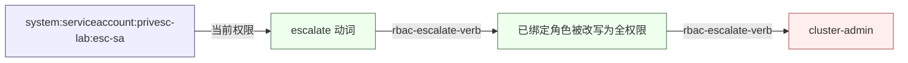
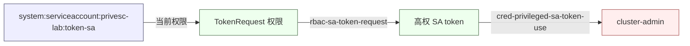

# InkBlade 提权报告（示例：RBAC 四条路径）

## 提权面

- 提权向量 47 条；图节点 65 / 边 78；目标 target:cloud-admin, target:cluster-admin, target:node-root
- 当前主体：`system:serviceaccount:privesc-lab:esc-sa`
- 检测：每向量 ≥1 条 Sigma/Falco 规则，紫队重放结果见 `privesc/coverage.json`

### 提权路径图

从「system:serviceaccount:privesc-lab:esc-sa」到「cluster-admin」：3 步，权重 2.3
1. 当前权限：快照中该主体已持有该权限（can-i/RoleBinding 推断）（ClusterRoleBinding/esc-editable-binding->esc-editable; ClusterRoleBinding/escalator-binding->escalator; ServiceAccount privesc-lab/esc-sa）
2. [rbac-escalate-verb] escalate 动词改写已绑定角色
   原语：用 escalate 把已绑定角色改写为 verbs/resources/apiGroups=*；既有绑定立即生效，无需重新授权。
   前置：escalate on roles 或 clusterroles；update/patch 已绑定角色（或用 create 自建角色后绑定）
   证据：Kubernetes RBAC 文档 https://kubernetes.io/docs/reference/access-authn-authz/rbac/
   检测：sigma:K8s audit：update/patch clusterroles/roles 且新 rules.verbs 含 *
结论：沿上述原语可到达目标；执行前需通过 ROE 级别、范围与备份闸门。

### 选择依据

按总权重优先选择：`inferred-grant → rbac-escalate-verb`；权重 2.3，3 步。同权重按跳数少优先；所有边模块均已在注册表登记；失败时按备选路径顺序回退。

### 备选路径

1. 权重 2.5 / 3 步：`inferred-grant → rbac-aggregated-clusterrole → rbac-escalate-verb`
2. 权重 3.6 / 4 步：`inferred-grant → cred-projected-token → cred-privileged-sa-token-use`
3. 权重 3.8 / 4 步：`inferred-grant → workload-hostpath-hostroot → node-host-root-kubeconfig`
4. 权重 3.8 / 4 步：`inferred-grant → workload-privileged-pod → node-host-root-kubeconfig`

---

# InkBlade Objective 报告

- Objective：`cluster-takeover` — ML 集群接管
- 起始主体：`system:serviceaccount:privesc-lab:token-sa`；目标：`cluster-admin`
- 阶段：4（侦察 → 立足 → 提权 → 影响）
- 结论：计划就绪（未执行）

## 提权面

- 选中路径：`inferred-grant → rbac-sa-token-request → cred-privileged-sa-token-use`
- 权重 2.3，3 步；备选 0 条
- 当前主体权限与路径步骤见下方路径图与选择依据。

### 提权路径图

从「system:serviceaccount:privesc-lab:token-sa」到「cluster-admin」：3 步，权重 2.3
1. 当前权限：快照中该主体已持有该权限（can-i/RoleBinding 推断）（ClusterRoleBinding/token-requester-binding->token-requester; ServiceAccount privesc-lab/token-sa; can-i:system:serviceaccount:privesc-lab:token-sa）
2. [rbac-sa-token-request] TokenRequest 申请高权 SA token
   原语：调用 TokenRequest 子资源为特权 SA 申请短期 token；无需读取 Secret 即可获得其身份。
   前置：create serviceaccounts/token；目标高权 ServiceAccount 存在
   证据：Kubernetes TokenRequest API https://kubernetes.io/docs/reference/kubernetes-api/authentication-resources/token-request-v1/
   检测：sigma:K8s audit：create serviceaccounts/token 子资源
3. [cred-privileged-sa-token-use] 高权 SA token 直接使用
   原语：以 Bearer token 调用 apiserver，创建 ClusterRoleBinding/特权 Pod；token 短期但足以完成接管。
   前置：持有高权 SA token；网络可达 apiserver
   证据：Kubernetes Secret 文档 https://kubernetes.io/docs/concepts/configuration/secret/
   检测：sigma:K8s audit：高权 SA 主体创建敏感绑定
结论：沿上述原语可到达目标；执行前需通过 ROE 级别、范围与备份闸门。

### 选择依据

按总权重优先选择路径 `inferred-grant → rbac-sa-token-request → cred-privileged-sa-token-use`：权重 2.3 (weight)、3 步；备选 0 条。排序规则：总权重 → 跳数 → 向量 id 字典序（稳定）；每条边的模块均已在注册表登记；执行失败时按备选顺序回退。

### 备选路径

（无备选；当前主体可能已是 cluster-admin）

### 检测键

- `rbac-sa-token-request` → sigma:K8s audit：create serviceaccounts/token 子资源
- `cred-privileged-sa-token-use` → sigma:K8s audit：高权 SA 主体创建敏感绑定

### 执行与回退

- 当前为 plan-only：未执行模块；执行前需通过 ROE/范围/备份闸门。

### 执行边界

本报告是授权关系/原语推演 + 计划；真实执行需 `--allow-write`、ROE 级别、范围与备份闸门同时通过，且失败步骤会留下审计与回退记录。